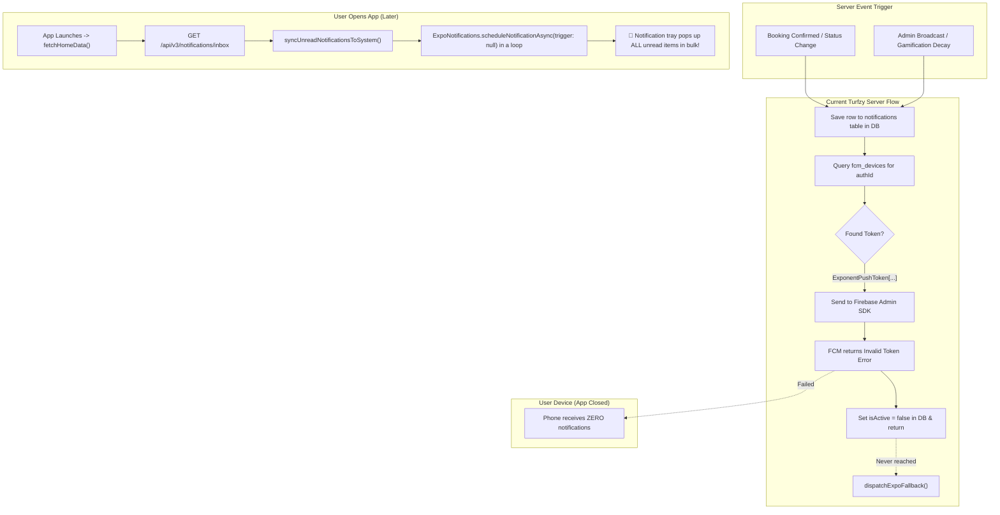
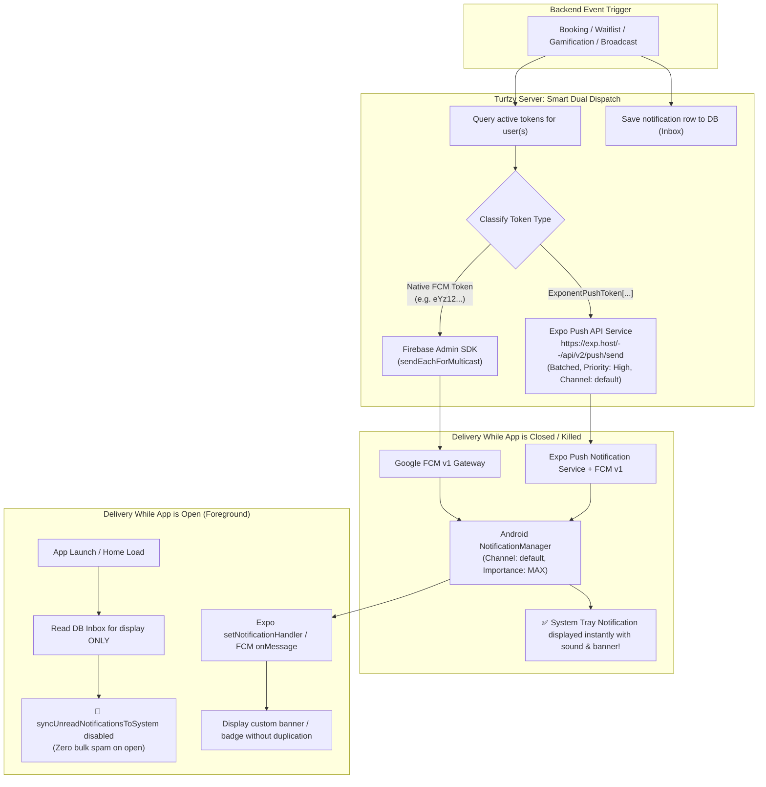
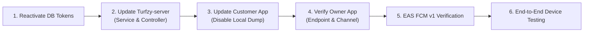

# Comprehensive Implementation Plan: Reliable Real-Time & Background Push Notification Architecture

## 1. Executive Summary & Root Cause Analysis

### 1.1 The Issue
* **Symptom 1:** When the Turfzy app is closed or killed, the physical device receives **no notifications**.
* **Symptom 2:** The exact moment the user opens the app, the notification drawer receives a **sudden bulk burst** of stacked notifications.

---

### 1.2 Root Cause Analysis from Code & Database Audit

#### Finding A: 100% of Production Device Tokens are Expo Push Tokens
Inspection of the PostgreSQL database (`fcm_devices` and `Auth` tables) revealed that **all active tokens** currently registered in the database are Expo Push Tokens formatted as:
```text
ExponentPushToken[pZjMZ7ERQTEX...]
```
No native FCM device tokens exist in the database.

#### Finding B: Server Tries to Send Expo Tokens to Firebase Admin SDK
In [src/common/notifications/notifications.service.ts](file:///mnt/ssd/sevenx%20labs/Turfzy/Turfzy-server/src/common/notifications/notifications.service.ts#L204-L234), `dispatchPushToUser`:
1. Queries `fcm_devices` where `isActive = true`.
2. Finds the `ExponentPushToken[...]`.
3. Calls `this.firebaseAdminService.sendEachForMulticast(fcmTokens, ...)`.
4. Firebase Admin SDK calls the Google FCM v1 API with the token.
5. Google FCM rejects the token immediately: `The registration token is not a valid FCM registration token` or `invalid-argument`.
6. [firebase-admin.service.ts](file:///mnt/ssd/sevenx%20labs/Turfzy/Turfzy-server/src/common/firebase/firebase-admin.service.ts#L127-L139) marks the token as `isUnregistered: true`.
7. `notifications.service.ts` calls `this.handleInvalidTokens([token])` which marks `isActive = false` in the database.
8. `dispatchPushToUser` executes `return;` immediately.
9. **`dispatchExpoFallback()` is never reached.**
10. Consequently, **no remote push notification is ever delivered while the app is closed**.

#### Finding C: Owner App Calls Non-Existent Endpoint (HTTP 404)
In [Turfzy-owner-app/src/services/notificationService.ts:L111](file:///mnt/ssd/sevenx%20labs/Turfzy/Turfzy-owner-app/src/services/notificationService.ts#L111):
* The owner app sends its push token to: `POST /api/v3/notifications/register-token`.
* In [Turfzy-server/src/common/notifications/notifications.controller.ts:L32](file:///mnt/ssd/sevenx%20labs/Turfzy/Turfzy-server/src/common/notifications/notifications.controller.ts#L32), the only defined endpoint is: `POST /api/v3/notifications/save-token`.
* The server responds with `404 Not Found`. Owner tokens are never saved on the server.

#### Finding D: The "Bulk on Open" Mechanism Explained
In [Turfzy-customer-app/app/customer/(tabs)/home/index.tsx:L118-L127](file:///mnt/ssd/sevenx%20labs/Turfzy/Turfzy-customer-app/app/customer/(tabs)/home/index.tsx#L118-L127) and [notifications/index.tsx:L85](file:///mnt/ssd/sevenx%20labs/Turfzy/Turfzy-customer-app/app/customer/(tabs)/notifications/index.tsx#L85):
* When the user opens the app, `fetchHomeData()` calls `getNotificationInbox(1, 3)`.
* It then calls `syncUnreadNotificationsToSystem(list)`.
* In [Turfzy-customer-app/src/services/notificationService.ts:L481-L523](file:///mnt/ssd/sevenx%20labs/Turfzy/Turfzy-customer-app/src/services/notificationService.ts#L481-L523):
  ```typescript
  for (const notification of unreadToDeliver) {
    await ExpoNotifications.scheduleNotificationAsync({
      content: { ... },
      trigger: null, // Schedules an IMMEDIATE local device notification
    });
  }
  ```
* Because remote push notifications failed while the app was closed, unread notifications accumulated in the PostgreSQL database.
* Upon launching the app, this function looped through the accumulated database records and fired all of them as **instant local alerts**, creating the illusion of a bulk delayed delivery.

---

## 2. Architecture Comparison

### 2.1 Current Broken Architecture


---

### 2.2 Target Robust Dual-Channel Architecture


---

## 3. Step-by-Step Implementation Plan

### Phase 1: Database Token Audit & Recovery (Turfzy-server)

#### Task 1.1: Reactivate Inactivated Expo Push Tokens
Because the previous code falsely flagged Expo tokens as unregistered when sending them to Firebase Admin, active user tokens were marked `is_active = false`.
* **Action:** Run a migration query to restore `is_active = true` for all Expo push tokens updated within the last 90 days.
* **SQL Query:**
  ```sql
  UPDATE "fcm_devices"
  SET "is_active" = true, "updated_at" = NOW()
  WHERE "fcm_token" LIKE 'ExponentPushToken[%'
     OR "fcm_token" LIKE 'expo.v2:%';
  ```

---

### Phase 2: Turfzy-server Backend Implementation

#### Task 2.1: Update `NotificationsController` Endpoint Routing
**File:** [src/common/notifications/notifications.controller.ts](file:///mnt/ssd/sevenx%20labs/Turfzy/Turfzy-server/src/common/notifications/notifications.controller.ts)
* **Goal:** Allow both `/save-token` (used by customer app) and `/register-token` (used by owner app) to resolve to the same handler.
* **Modifications:**
  1. Add `@Post('register-token')` decorator to the existing `saveToken` method.
  2. Ensure the controller supports all field names: `token`, `fcmToken`, `expoPushToken`.
  3. Ensure device ID de-duplication works for both client apps.

#### Task 2.2: Refactor `NotificationsService` Core Push Logic
**File:** [src/common/notifications/notifications.service.ts](file:///mnt/ssd/sevenx%20labs/Turfzy/Turfzy-server/src/common/notifications/notifications.service.ts)
* **Goal:** Intelligently partition recipient tokens into native FCM tokens and Expo tokens, and dispatch each batch to its dedicated sender.
* **Key Enhancements:**
  1. Add token validator:
     ```typescript
     public isExpoPushToken(token: string): boolean {
       if (!token || typeof token !== 'string') return false;
       const trimmed = token.trim();
       return trimmed.startsWith('ExponentPushToken[') || trimmed.startsWith('expo.v2:');
     }
     ```
  2. Implement `dispatchExpoBatch(tokens: string[], title: string, body: string, data?: any)`:
     * Chunks tokens into batches of 100 (Expo API limit).
     * Builds standard Expo push message payload:
       ```typescript
       {
         to: token,
         sound: 'default',
         title,
         body,
         data: data || {},
         channelId: 'default',
         priority: 'high',
         _displayInForeground: true,
       }
       ```
     * Injects `Authorization: Bearer ${EXPO_ACCESS_TOKEN}` if defined in environment.
     * Parses the Expo ticket response array and automatically identifies `DeviceNotRegistered` errors to deactivate dead tokens in `fcmDevice`.
  3. Refactor `dispatchPushToUser(authId: string, title: string, body: string, data?: any)`:
     * Fetch all active tokens for the user from `fcmDevice` and `Auth.expoPushToken`.
     * Split tokens:
       * `expoTokens = tokens.filter(t => this.isExpoPushToken(t))`
       * `nativeFcmTokens = tokens.filter(t => !this.isExpoPushToken(t))`
     * Run both dispatches in parallel using `Promise.allSettled`.
     * **CRITICAL:** Never pass `expoTokens` to `firebaseAdminService`.
  4. Refactor `sendMulticastNotification(authIds: string[], title: string, body: string, data?: any)`:
     * Currently, `sendMulticastNotification` only sends to Firebase Admin.
     * Update it to collect all target user tokens, partition into Expo vs FCM, and send to both services in bulk.

---

### Phase 3: Turfzy-owner-app Alignment

#### Task 3.1: Token Registration & Verification
**File:** [Turfzy-owner-app/src/services/notificationService.ts](file:///mnt/ssd/sevenx%20labs/Turfzy/Turfzy-owner-app/src/services/notificationService.ts)
* **Goal:** Ensure owner app registration succeeds, persists locally, and handles channel creation with maximum priority on Android.
* **Verifications:**
  1. The API call `api.post('/api/v3/notifications/register-token', { token, platform })` will now match the server route.
  2. Android Notification Channel configuration:
     ```typescript
     await Notifications.setNotificationChannelAsync('default', {
       name: 'Turfzy Partner Notifications',
       description: 'New booking alerts, payments, and turf check-ins.',
       importance: Notifications.AndroidImportance.MAX,
       vibrationPattern: [0, 250, 250, 250],
       lightColor: '#ADFF00',
       sound: 'default',
       enableVibrate: true,
       showBadge: true,
     });
     ```
  3. Ensure `projectId` in `Notifications.getExpoPushTokenAsync({ projectId })` properly reads `Constants.expoConfig?.extra?.eas?.projectId` (`21d047a1-751f-45df-bce2-a45a45b55b10`).

#### Task 3.2: Cold Start & Background Tap Navigation
**File:** [Turfzy-owner-app/src/hooks/useNotifications.ts](file:///mnt/ssd/sevenx%20labs/Turfzy/Turfzy-owner-app/src/hooks/useNotifications.ts)
* Verify both listeners are active:
  * `Notifications.addNotificationResponseReceivedListener` (background tap).
  * `Notifications.getLastNotificationResponseAsync` (cold start from killed state).
* Ensure taps navigate to `/booking/[id]` with highlight parameters.

---

### Phase 4: Turfzy-customer-app Alignment

#### Task 4.1: Eliminate the Unread Notification Flood
**Files:**
* [Turfzy-customer-app/app/customer/(tabs)/home/index.tsx:L126](file:///mnt/ssd/sevenx%20labs/Turfzy/Turfzy-customer-app/app/customer/(tabs)/home/index.tsx#L126)
* [Turfzy-customer-app/app/customer/(tabs)/notifications/index.tsx:L85](file:///mnt/ssd/sevenx%20labs/Turfzy/Turfzy-customer-app/app/customer/(tabs)/notifications/index.tsx#L85)
* [Turfzy-customer-app/src/services/notificationService.ts:L481-L523](file:///mnt/ssd/sevenx%20labs/Turfzy/Turfzy-customer-app/src/services/notificationService.ts#L481-L523)

* **Goal:** Prevent the app from dumping unread database records as local device alerts on launch.
* **Action:**
  * In `home/index.tsx`, remove or comment out `syncUnreadNotificationsToSystem(list);`.
  * In `notifications/index.tsx`, remove or comment out `syncUnreadNotificationsToSystem(incomingList);`.
  * Deprecate `syncUnreadNotificationsToSystem` in `notificationService.ts`. Unread notifications will simply display inside the app's notification tab and badge counter, without triggering noisy system tray notifications.

#### Task 4.2: Android Channel & Permission Verification
**File:** [Turfzy-customer-app/src/services/notificationService.ts](file:///mnt/ssd/sevenx%20labs/Turfzy/Turfzy-customer-app/src/services/notificationService.ts)
* Verify channel settings match server payload `channelId: 'default'`.
* Ensure notification permissions are requested on Android 13+ (`POST_NOTIFICATIONS`).

#### Task 4.3: Entry Point Initialization Order
**File:** [Turfzy-customer-app/index.js](file:///mnt/ssd/sevenx%20labs/Turfzy/Turfzy-customer-app/index.js)
* Ensure `notificationService` background handlers are registered as early as possible in `index.js`.

---

### Phase 5: Google Cloud / Firebase & EAS Configuration (FCM v1)

Google deprecated the legacy FCM HTTP server keys in June 2024. For Expo Push Notifications to deliver to Android devices when the app is in the background or killed:

1. **Verify Firebase Project:**
   * Firebase Project ID: `turfzy-8e854`.
   * Project Number: `1071648366014`.
2. **EAS FCM v1 Service Account Key Setup:**
   * Both EAS projects need the Google Cloud Service Account Private Key:
     * Customer App EAS Project: `b7c6a6a2-2cd7-4192-a2fc-69a645c9df2a`
     * Owner App EAS Project: `21d047a1-751f-45df-bce2-a45a45b55b10`
   * In terminal:
     ```bash
     cd Turfzy-customer-app
     eas credentials
     # Select: Android -> production/development -> Push Notifications -> Set up FCM V1
     # Provide the Firebase Service Account JSON key
     ```
   * Or upload directly via the Expo Dashboard: **Project Settings -> Credentials -> Android -> FCM V1 Service Account**.

---

## 4. Code Implementation Details

### 4.1 Server: `src/common/notifications/notifications.controller.ts`
```typescript
  @Post('save-token')
  @Post('register-token') // Added alias for Turfzy-owner-app
  @UseGuards(JwtAuthGuard)
  @HttpCode(HttpStatus.OK)
  @ApiOperation({ summary: 'Register or refresh client device push token (FCM or Expo)' })
  @ApiResponse({ status: 200, description: 'Token registered successfully' })
  async saveToken(@Req() req: any, @Body() body: SaveTokenDto) {
    const { authId } = req.user;
    const token = (body.token || body.fcmToken || body.expoPushToken || '').trim();

    if (!token) {
      throw new BadRequestException('Push registration token is required');
    }

    if (token.length < 5 || token.length > 4096) {
      throw new BadRequestException('Invalid push registration token length');
    }

    const platform = (body.platform || 'android').toLowerCase();
    const deviceId = body.deviceId?.trim() || undefined;

    return this.notificationsService.registerDevice(
      authId,
      token,
      platform,
      deviceId,
    );
  }
```

---

### 4.2 Server: `src/common/notifications/notifications.service.ts`

```typescript
  /**
   * Helper to identify if a token belongs to Expo Push Service
   */
  public isExpoPushToken(token: string): boolean {
    if (!token || typeof token !== 'string') return false;
    const trimmed = token.trim();
    return trimmed.startsWith('ExponentPushToken[') || trimmed.startsWith('expo.v2:');
  }

  /**
   * Send push notification to multiple Expo push tokens in batches of 100
   */
  public async dispatchExpoBatch(
    tokens: string[],
    title: string,
    body: string,
    data?: any,
  ): Promise<void> {
    const validTokens = [...new Set(tokens.filter((t) => this.isExpoPushToken(t)))];
    if (validTokens.length === 0) return;

    const expoAccessToken = this.configService.get<string>('EXPO_ACCESS_TOKEN');
    const headers: Record<string, string> = {
      'Content-Type': 'application/json',
      Accept: 'application/json',
      'Accept-Encoding': 'gzip, deflate',
    };
    if (expoAccessToken) {
      headers['Authorization'] = `Bearer ${expoAccessToken}`;
    }

    // Expo Push API accepts maximum 100 messages per request
    const batchSize = 100;
    for (let i = 0; i < validTokens.length; i += batchSize) {
      const batch = validTokens.slice(i, i + batchSize);
      const messages = batch.map((token) => ({
        to: token,
        title,
        body,
        sound: 'default',
        priority: 'high',
        channelId: 'default',
        _displayInForeground: true,
        data: data || {},
      }));

      try {
        const response = await axios.post(this.expoUrl, messages, {
          headers,
          httpsAgent: this.httpsAgent,
          timeout: 8000,
        });

        // Check tickets for unregistered tokens
        const tickets = response.data?.data || [];
        const unregisteredTokens: string[] = [];

        tickets.forEach((ticket: any, idx: number) => {
          if (ticket.status === 'error') {
            this.logger.warn(`Expo push error for token ${batch[idx].slice(0, 15)}...: ${ticket.message} (${ticket.details?.error})`);
            if (ticket.details?.error === 'DeviceNotRegistered') {
              unregisteredTokens.push(batch[idx]);
            }
          }
        });

        if (unregisteredTokens.length > 0) {
          await this.handleInvalidTokens(unregisteredTokens);
        }
      } catch (error: any) {
        this.logger.error(`Failed to dispatch Expo push batch: ${error.message}`);
      }
    }
  }

  /**
   * Helper to dispatch push notification across all registered devices for a user
   */
  private async dispatchPushToUser(
    authId: string,
    title: string,
    body: string,
    data?: any,
  ) {
    // 1. Query active devices from DB
    const devices = await this.prisma.fcmDevice.findMany({
      where: { authId, isActive: true },
      select: { fcmToken: true },
    });

    const tokenSet = new Set<string>(
      devices.map((d) => d.fcmToken.trim()).filter(Boolean),
    );

    // 2. Fallback check for Auth.expoPushToken
    const userAuth = await this.prisma.auth.findUnique({
      where: { id: authId },
      select: { expoPushToken: true },
    });

    if (userAuth?.expoPushToken) {
      tokenSet.add(userAuth.expoPushToken.trim());
    }

    const allTokens = Array.from(tokenSet);
    if (allTokens.length === 0) {
      this.logger.log(`No active push tokens for user ${authId}, saved to inbox only`);
      return;
    }

    const expoTokens: string[] = [];
    const nativeFcmTokens: string[] = [];

    for (const token of allTokens) {
      if (this.isExpoPushToken(token)) {
        expoTokens.push(token);
      } else {
        nativeFcmTokens.push(token);
      }
    }

    const promises: Promise<any>[] = [];

    // Dispatch Expo push tokens via Expo Push Service
    if (expoTokens.length > 0) {
      promises.push(
        this.dispatchExpoBatch(expoTokens, title, body, data).catch((err) =>
          this.logger.error(`Expo dispatch error for user ${authId}: ${err.message}`),
        ),
      );
    }

    // Dispatch native FCM tokens via Firebase Admin SDK
    if (nativeFcmTokens.length > 0) {
      promises.push(
        this.firebaseAdminService
          .sendEachForMulticast(nativeFcmTokens, {
            title,
            body,
            data: data || {},
          })
          .then(async (result) => {
            const unregistered = result.failedTokens
              .filter((f) => f.isUnregistered)
              .map((f) => f.token);
            if (unregistered.length > 0) {
              await this.handleInvalidTokens(unregistered);
            }
          })
          .catch((err) =>
            this.logger.error(`Native FCM dispatch error for user ${authId}: ${err.message}`),
          ),
      );
    }

    await Promise.allSettled(promises);
  }
```

---

### 4.3 Customer App: Remove Bulk Alert Dump on Launch

In `Turfzy-customer-app/app/customer/(tabs)/home/index.tsx`:
```diff
         // 5. Recent Notifications
         try {
           const notifRes = await getNotificationInbox(1, 3, forceRefresh);
           if (notifRes.success) {
             let list = notifRes.data;
             let currentCount = notifRes.meta.unreadCount;

             setUnreadCount(currentCount);
             setRecentNotifications(list);
-            syncUnreadNotificationsToSystem(list);
+            // syncUnreadNotificationsToSystem disabled to prevent local alert spam on launch
           }
         } catch (err: any) {
           console.error('[Notification Error]', err);
         }
```

In `Turfzy-customer-app/app/customer/(tabs)/notifications/index.tsx`:
```diff
         if (res.success) {
           const incomingList = res.data;
           setNotifications(incomingList);
           setUnreadCount(res.meta.unreadCount);
-          syncUnreadNotificationsToSystem(incomingList);
+          // syncUnreadNotificationsToSystem disabled to prevent local alert spam on launch
         }
```

---

## 5. Verification & Testing Checklist

| Step | Action | Expected Result |
| :--- | :--- | :--- |
| **1. Database Fix** | Execute SQL reactivation query on `fcm_devices`. | Inactive Expo tokens restored to `is_active = true`. |
| **2. Server Build** | Compile and run `Turfzy-server`. | NestJS compiles with 0 errors; routes `/save-token` and `/register-token` active. |
| **3. Owner App Token Registration** | Open `Turfzy-owner-app` on a physical device. | Logs show `Token registered with backend (HTTP 200)`. |
| **4. Customer App Token Registration** | Open `Turfzy-customer-app` on a physical device. | Logs show `Successfully registered push token at backend`. |
| **5. Test Endpoint Push** | Call `GET /api/v3/notifications/test` while authenticated. | Notification delivered to device while app is in foreground and background. |
| **6. Closed / Killed App Delivery** | Force-close / kill the app, turn screen off, trigger a test notification from server. | Notification appears immediately in phone system tray with sound, banner, and Turfzy icon. |
| **7. Launch Bulk Test** | Open the app after accumulating 3 notifications. | Home screen renders without any local alert popups; inbox badge displays "3". |
| **8. Cold Start Deep Link** | Tap the notification from the system tray while app is killed. | App opens directly to the targeted booking detail screen. |

---

## 6. Implementation Timeline & Sequence


